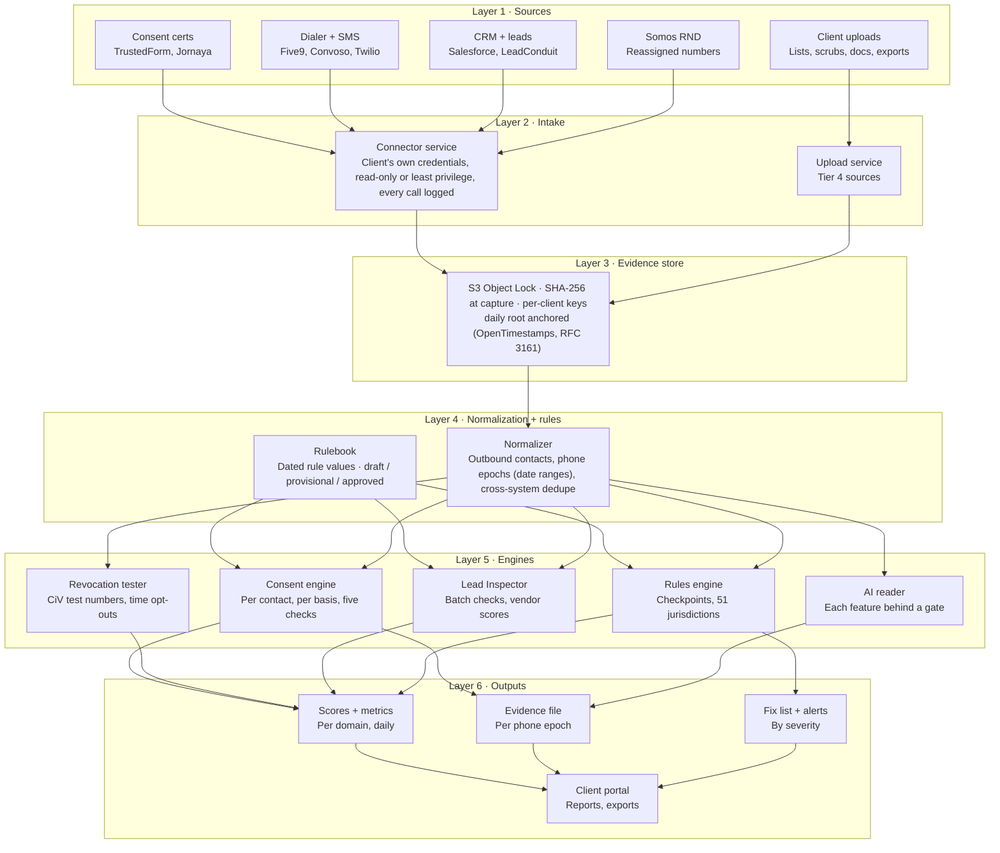
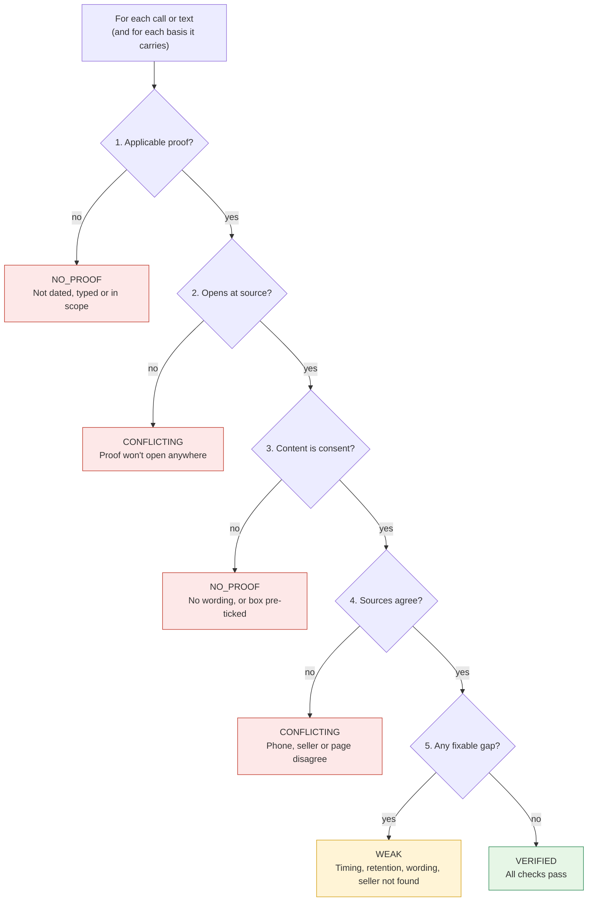
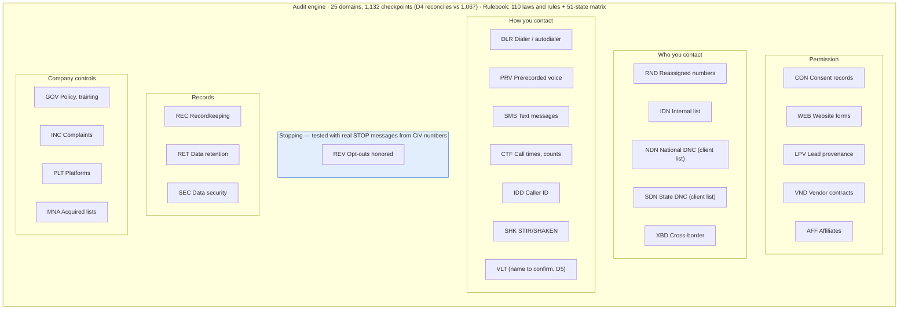

# Architecture — CiV Automated TCPA Audit System

**Version:** 1.1 · **Date:** 2026-10-01 · **Status:** Draft for engineering review
**Companion documents:** [design.md](design.md) (detailed design), [specs/01-engineering-spec.md](specs/01-engineering-spec.md)

---

## 1. Architectural principles

1. **Evidence first.** Nothing is checked until its raw source has been hashed into the evidence store. The store is the system of record; the database holds metadata and derived results that can always be rebuilt from the store.
2. **Pure evaluation.** The consent engine and rules engine are deterministic functions of (normalized data, rulebook version, `evaluation_as_of`, code version). No wall-clock reads, no network calls, no randomness.
3. **Versioned everything.** Rows are closed, never overwritten. Rulebooks are versioned. AI outputs are stored with model and prompt version. Every result links to its `run`.
4. **Tenant isolation by construction.** `client_id` on every table, row-level security enforced in Postgres, per-client encryption keys for artifact content.
5. **Fail to "not measured", never to a guess.** A missing source, a stale connector, an ungated AI feature or a TBD parameter yields `not_run` / "not measured" with a reason, never a pass and never a silent default.
6. **Small, bounded units.** Each component has one purpose, a defined interface and can be tested with fixtures alone.

## 2. System context

```
                          ┌──────────────────────────────────────────────┐
   Client systems         │              CiV Audit System                │        External
   (client credentials)   │                                              │        (CiV accounts)
                          │                                              │
   TrustedForm ──────────▶│  Connector    Upload                         │◀──── Somos RND
   Jornaya     ──────────▶│  service      service                        │◀──── Carrier lookup
   Five9/Convoso ────────▶│      │           │                           │◀──── Email verification
   Twilio      ──────────▶│      ▼           ▼                           │◀──── RDAP
   Salesforce/HubSpot ───▶│  ┌─────────────────────┐                     │◀──── OpenTimestamps
   LeadConduit ──────────▶│  │   Evidence store    │                     │◀──── RFC 3161 TSA
   Client uploads ───────▶│  └─────────────────────┘                     │◀──── LLM provider
                          │            │                                 │
   Public consent pages ─▶│  Page      ▼                                 │
   (headless browser)     │  capture  Normalizer ──▶ Engines ──▶ Outputs │────▶ Client portal
                          │                                              │────▶ Alerts (email / counsel)
   CiV test numbers ◀────▶│  Revocation tester / inbound handler         │────▶ Evidence file export
                          └──────────────────────────────────────────────┘
```

## 3. The six layers (as in the v1.0 diagram)

The layer structure is the one drawn in the v1.0 Engineering Spec: *every
source lands as hashed evidence before any check runs.*



| Layer | Components | Input | Output | Key requirement (v1.0) + v1.1 additions |
|---|---|---|---|---|
| **1 Sources** | Consent certs, dialer + SMS, CRM + leads, Somos RND, client uploads; *v1.1 adds* carrier lookup, email verification, RDAP, CiV page captures, CiV test numbers | — | Raw records | Vendor terms confirmed before each adapter |
| **2 Intake** | Connector service, Upload service | Client credentials, files | Raw artifacts (bytes + metadata) | Client-owned credentials, read-only or least-privilege, every call in `access_log`; uploads record uploader, time, hash |
| **3 Evidence store** | Object store (S3 Object Lock), hasher, Merkle anchor job, key manager, deletion / legal-hold service | Raw artifacts | `artifact` rows, hashes, anchors, inclusion paths | SHA-256 at capture; daily anchoring; *v1.1:* per-client keys, legal hold, inclusion proofs |
| **4 Normalization + rules** | Normalizer, deduper, epoch resolver, location resolver; Rulebook loader | Artifacts; rulebook version | `contact_event`, `consent_proof`, `opt_out_event`, `lead`, `phone_epoch`, `address_version`; resolved rule values | Dedupe across systems only; time zone from ZIP; epochs as ranges with certainty; *v1.1:* provisional rulebook, `affects_status` approval |
| **5 Engines** | Consent engine, Revocation tester, Lead Inspector, AI reader, Rules engine | Normalized rows, rulebook, `evaluation_as_of` | `consent_evaluation`, `revocation_test`, `lead_result`, `ai_output`, `checkpoint_result` | Same inputs + `evaluation_as_of` = same result; each result references checkpoint, run and rule values; *v1.1:* per-basis evaluation, strict/lenient variants, checkpoint aggregation |
| **6 Outputs** | Metric calculator + scorer, Evidence file builder, Finding generator + Alert router, Portal | Engine rows | Scores, evidence files, fix list, alerts, portal | Sections 7 and 9 of the spec; banned-word check; *v1.1:* internal-only visibility for provisional runs |

Data flows strictly downward. A layer may read anything below it and never writes to a layer above. Re-running any layer from a stored input reproduces its output.

### 3.1 Consent decision per contact (v1.0 diagram, v1.1 ranking)



Each proof gets a status from its first failing step; the best proof wins
(VERIFIED > WEAK > CONFLICTING > NO_PROOF, ties to the most recent capture);
the contact's status is the worst across its bases.

### 3.2 Audit engine: 25 domains in 6 families (v1.0 diagram)



### 3.3 Build phases and gates (v1.0 diagram, v1.1 adds Phase 0)

```mermaid
flowchart LR
  P0["0. Upload-only pilot<br/>Evidence store · Normalizer<br/>Phone epochs · Consent engine<br/>(provisional rulebook)"]
  P1["1. Foundation<br/>Connectors · Secrets<br/>Sync + health · Rulebook admin"]
  P2["2. Consent<br/>Certificate retrieval · Page capture<br/>Checklist rules · Seller match<br/>Lead checks 2–3"]
  P3["3. Revocation<br/>Test numbers · Annex C<br/>Propagation matrix"]
  P4["4. Metrics<br/>28 + 5 metrics · Aggregation<br/>Scoring · Lead check 1 · Scorecards"]
  P5["5. AI features<br/>Contracts · Transcription<br/>Opt-out text · Page meaning"]
  PP["Post-pilot<br/>Live Lead Inspector"]
  P0 -->|"Gate 0: hand-check agrees;<br/>cost per number"| P1
  P1 -->|"Gate 1: client synced<br/>and anchored"| P2
  P2 -->|"Gate 2: hand-check +<br/>counsel items"| P3
  P3 -->|"Gate 3: first matrix<br/>delivered"| P4
  P4 -->|"Gate 4: all metrics<br/>on pilot"| P5
  P5 -->|"Gate per AI feature"| PP
  PP -->|"Terms + uptime SLA"| L["Launch<br/>Counsel C1, C2, C6–C10<br/>SOC 2 Type I · DPAs · Pen test"]
  CB["Counsel brief settles settings and questions in parallel from day one"]
  CB -.-> P0
  CB -.-> P2
  CB -.-> P4
```



## 4. Component catalogue

For each component: purpose, interface, dependencies, key invariants. Detailed algorithms are in [design.md](design.md).

### 4.1 Connector service (Layer 2 · Intake)

- **Purpose:** pull records from client tools through published APIs; one adapter per vendor behind a common interface.
- **Interface:** `Adapter.backfill(client, since, until) → Iterator[RawRecord]`, `Adapter.incremental(client, cursor) → (Iterator[RawRecord], cursor)`, `Adapter.webhook(payload) → RawRecord`, `Adapter.health() → {last_sync, freshness_ok}`.
- **Dependencies:** secrets vault (credentials), access log (every call), evidence store (writes raw response bytes).
- **Invariants:** hashes the *raw response bytes*, not a re-serialized object; never calls a billed vendor operation without a stored written approval; never a write scope.
- **Adapters, in pilot order (D3):** TrustedForm Certificate API v4, then the pilot client's dialer, SMS platform, CRM, lead platform.

### 4.2 Upload service (Layer 2 · Intake)

- **Purpose:** accept client files where no API exists; record uploader, time, hash; tier 4.
- **Interface:** `POST /uploads` (multipart) → `artifact_id`; declared `upload_type` (dialer_export, dnc_scrub, litigator_list, complaint_log, contract, policy, training_log, recording, signed_form, rnd_query_log).
- **Invariants:** stored byte-for-byte; parsing happens in L3, never on upload.

### 4.3 Page capture (Layers 1–2 · CiV-captured source)

- **Purpose:** render public consent pages with a headless browser; store screenshot, DOM, normalized text, measurements; tier 1.
- **Interface:** `capture(url, viewports) → page_capture`, scheduled per `page_capture_interval_hours` for every known consent URL (client forms + every `capture_url` from leads + partner-list links).
- **Invariants:** normalization removes only `page_normalize_rules` parts before hashing; pages that block capture are recorded as "not captured".

### 4.4 RND client (Layers 1–2 · CiV account source)

- **Purpose:** query the Reassigned Numbers Database on CiV's own caller-agent account; tier 1.
- **Interface:** `query(phone, date_asked_about) → yes | no | no_data`, budgeted by `rnd_query_budget_per_number`.
- **Invariants:** every query logged in `rnd_query_log` with `queried_by = civ`; never counted as the client's pre-contact check (M11).

### 4.5 Inbound handler (Layers 1–2 · CiV test numbers)

- **Purpose:** record every call and text to CiV test numbers; feed the revocation tester.
- **Invariants:** every inbound stored as an artifact; spoken tests play the recording notice until C5 is decided.

### 4.6 Evidence store (Layer 3)

- **Purpose:** keep every raw artifact exactly as received, tamper-evident, per-client encrypted, with legal hold.
- **Interface:** `put(client, bytes, meta) → artifact`, `get(artifact_id) → bytes` (logged), `anchor_daily()`, `inclusion_proof(artifact_id) → path`, `delete(artifact_id, reason, approver)`, `legal_hold(client, on|off)`.
- **Storage:** Amazon S3 with Object Lock in compliance mode, retention set to `retention_until` at write; SSE-KMS with one customer-managed key per client.
- **Deletion:** content deletion = destruction of the client key (crypto-shredding) recorded in `deletion_log`; the `artifact` row and hash remain. Legal hold blocks key destruction and sets S3 Legal Hold on the client's prefix.
- **Anchoring:** nightly job builds a Merkle tree over the day's `sha256` values, stores root, OpenTimestamps proof and RFC 3161 token in `merkle_anchor`, and each artifact's `leaf_index` + `merkle_path`.

### 4.7 Normalizer (Layer 4)

- **Purpose:** parse artifacts into canonical rows; dedupe across systems; resolve recipient location; version address history.
- **Interface:** `normalize(artifact) → rows`, idempotent on `(artifact_id, parser_version)`.
- **Invariants:** only `direction = outbound` rows become contacts; dedupe matches across systems only; two same-system records never merge; dialer/SMS record wins; every row carries `source_artifact_id`.

### 4.8 Epoch resolver (Layer 4)

- **Purpose:** split a phone number's history into epochs (one holder each) using RND answers and carrier signals; assign contacts and proofs to epochs.
- **Interface:** `resolve(client, phone) → [phone_epoch]`, `assign(event_or_proof) → contact_epoch_assignment`.
- **Invariants:** boundaries stored as ranges; certainty known / bounded / unknown; a contact inside a bounded range is "reassignment uncertain"; unknown is never treated as the same person.

### 4.9 Rulebook loader (Layer 4)

- **Purpose:** load a `rulebook_version` and resolve, for any (key, jurisdiction, date, client), the value in force.
- **Interface:** `Rulebook.load(version_id) → Rulebook`, `rb.value(key, on_date, jurisdiction=None, client_id=None)`.
- **Invariants:** refuses to load if `vs_rate_weights` do not sum to 1, if any `affects_status` key is unapproved in an `approved` version, or if a required key is missing; `provisional` and `draft` versions load but taint every run they feed (`run.output_visibility = internal`).

### 4.10 Consent engine (Layer 5)

- **Purpose:** decide one status per contact per basis, then per contact.
- **Interface:** `evaluate(contact_event, proofs, opt_outs, epoch, rb, evaluation_as_of) → consent_evaluation`.
- **Invariants:** pure function; every reason code stored; AI items only after gate; frozen contacts skipped; strict/lenient variants run when a rulebook is provisional and a key has `variants`.

### 4.11 Rules engine (Layer 5)

- **Purpose:** run every automatable checkpoint from CIV-ATP-01; aggregate per-contact results by `checkpoint.aggregation`.
- **Interface:** `run_checkpoints(client, run) → [checkpoint_result]`.
- **Invariants:** `not_run` / `NEEDS_SOURCE` when a source is missing; each result references checkpoint, run and rule values used.

### 4.12 Lead Inspector (Layer 5)

- **Purpose:** Checks 1–3 per lead; vendor scorecard; dispute candidates.
- **Interface:** `inspect(lead, rb) → lead_result`, `scorecard(client, vendor, window) → vendor_score`.
- **Invariants:** batch only in v1; test leads excluded; never a consumer report.

### 4.13 AI reader (Layer 5)

- **Purpose:** every AI feature behind one interface with an accuracy gate.
- **Interface:** `ask(feature, inputs, prompt_version) → ai_output` with `confidence`; `gate_status(feature) → passed | not_passed`.
- **Invariants:** outputs cached by `(feature, input_artifact_ids, prompt_version, checklist_version, model)`; ungated features produce "not measured"; no AI output ever changes a status on its own below `ai_min_confidence`.

### 4.14 Revocation tester (Layer 5)

- **Purpose:** seed test identities, send opt-outs, time suppression across systems.
- **Interface:** `plan(client, annex_c) → tests`, `observe(test) → opt_out_suppression rows`, `matrix(run) → matrix_cell rows`.
- **Invariants:** no test without `annex_c_authorization`; seeds only through the client's public forms; NEVER after `optout_observation_days`.

### 4.15 Metric calculator and scorer (Layer 6)

- **Purpose:** compute every metric card; aggregate checkpoints to domain and overall scores; apply hard cap and provisional flag.
- **Interface:** `metrics(client, run) → [metric_snapshot]`, `score(client, run) → scores`.
- **Invariants:** 0 ÷ 0 = "not measured"; missing source = "not measured — {source} not supplied"; one decimal place display, bands on the unrounded value.

### 4.16 Delivery (Layer 6)

- **Evidence file builder:** per-epoch PDF + JSON, hash manifest, Merkle paths, anchor proofs, verifier script, certification template.
- **Report renderer:** templates → PDF / HTML; banned-word check blocks release; standard disclosure appended.
- **Alert router:** rules → channels; in counsel-directed mode routes only to `legal` role.
- **Portal API:** REST, role-based, every read in `access_log`; hides `internal` visibility runs from client roles.

## 5. Data flow, end to end (nightly run)

```
1. Connectors + uploads + captures write raw artifacts → evidence store (hash, tier, client key)
2. Anchor job rolls the day's hashes into a Merkle root → OpenTimestamps + RFC 3161
3. Normalizer parses new artifacts → contact_event, consent_proof, opt_out_event, lead, address_version
4. Epoch resolver assigns new contacts/proofs to epochs; queues RND queries within budget
5. Run row created: kind=nightly, evaluation_as_of=now, rulebook_version, code_version
6. Consent engine evaluates new contacts + contacts whose result depends on time or new data
7. Rules engine runs checkpoints; Lead Inspector runs on new leads; AI reader fills gated items
8. Metric calculator + scorer produce metric_snapshot rows and scores
9. Finding generator diffs against the last run → open/resolve findings
10. Alert router evaluates alert rules → sends (or routes to counsel)
11. Evidence file builder refreshes files for epochs with changed evaluations
12. Run closed; everything references run_id
```

Backfill runs are the same pipeline with `kind = backfill` over a date range and no alerts. Report runs (`kind = report`) re-evaluate nothing; they render from a chosen past run.

## 6. Technology stack

**Chosen by the owner on 2026-10-03:** a Next.js + TypeScript portal, a Django
(Python) backend, and PostgreSQL. Rows marked *Decided* are that choice; rows
marked *Proposed* are the conventional options that follow from it and are
confirmed in the plan of the module that first needs them. Build Plan v2
(Sep 24, 2026) proposed Supabase, Drizzle and Inngest; that proposal is not
adopted.

| Concern | Choice | Reason | Status |
|---|---|---|---|
| Portal (client and internal screens) | Next.js (App Router), React, TypeScript | One app for every screen; typed contract with the backend | Decided |
| Backend | Django (Python) | Mature framework for data-heavy work; admin, migrations and auth built in; strong tooling for large files, audio and PDFs | Decided |
| Database | PostgreSQL, with row-level security on every tenant table | Versioned rows, RLS, JSONB for reason codes and rule values | Decided |
| API | Django REST Framework; OpenAPI schema generated from the code (drf-spectacular) and checked against `frontend/src/api/types.ts` | The portal's contract file and the backend cannot drift apart unnoticed | Decided (Django REST Framework); schema check proposed |
| Logins | Django authentication with session cookies; the portal reaches the API on the same origin through `/api` | No tokens in the browser; one place for roles | Decided |
| Schema changes | Django migrations | Built in; every change is a file in the repository | Decided with Django |
| Artifact storage | Amazon S3, Object Lock compliance mode, SSE-KMS per-client keys | Write-once with legal hold | Eng Spec v1.0 §10; ADR-1 |
| Queue and cache | Redis | Chosen by the owner | Decided |
| Background jobs | Celery, using Redis as its queue | The conventional Django task runner; retries, scheduling, long backfills | Decided |
| Engines | Python: normalizer, epoch resolver, consent engine, rules engine, metrics. SQL for set-based checks over large tables | Deterministic, fixture-tested functions; large files processed where they live | Decided with Django |
| Headless browser | Playwright (Chromium) | Viewport control, DOM + screenshot capture, font-size and contrast measurements | Proposed |
| Time zones | IANA tz database via `zoneinfo`; ZIP→tz reference table; NANP area-code table | Daylight saving, local weekday and holidays | Eng Spec |
| Anchoring | RFC 3161 timestamp authority and OpenTimestamps | Two independent external anchors | Eng Spec v1.0 §10 |
| Secrets | AWS Secrets Manager (or the host's equivalent) | Client-revocable credentials, audit trail | Proposed (module 8) |
| Document AI | Provider and model not chosen; model and prompt version stored with every output | Each feature must pass its accuracy gate whatever the model | Open (module 12) |
| Reports | WeasyPrint for PDF, openpyxl for sheets | Reproducible rendering in Python | Proposed |
| Errors and observability | Sentry; per-run metrics in the `run` row | Alerts on failures; run duration, source health, cost counters | Proposed |
| Hosting | Not chosen. The whole project is completed and run locally first; hosting is decided afterwards | Owner's decision, 2026-10-03 | Deferred (D16) |
| Local development | PostgreSQL and Redis on the developer's machine; a local S3-compatible store with object lock (for example MinIO) stands in for S3 | The evidence store's write-once behaviour can be built and tested before any cloud account exists | Decided (a local stand-in); MinIO as the tool is proposed |
| Tests | Portal: Vitest + Testing Library + MSW. Backend: pytest + pytest-django with fixture suites per gate | Every gate's test suite runs before a module is called done | Proposed |

**Repository layout and conventions (owner, 2026-10-03).** Two separate
folders, `frontend/` (Next.js) and `backend/` (Django); neither imports from
the other. Each roadmap module has its own files: one Django app per backend
module, one component per file in the frontend (never one file holding all components). Comments
are short and only where the reason is not obvious from the code.

**How the two halves meet.** The portal only ever calls paths under `/api`.
While the frontend is built first (module 1), a mock inside the Next.js app
answers those paths. From module 6, the mock is deleted and Next.js forwards
`/api/*` to the Django API, so no screen changes.

**Existing infrastructure, not adopted.** Two Supabase projects exist from
earlier work: `FCC` (`hoyinfxpotpwkhzsgime`, active; prospecting data plus
empty `tenant`, `membership`, `audit`, `document`, `alert`, `audit_log`,
`civ_artifact` tables) and `civ-platform-prod` (`rbbiwudeycfecmuvyrdf`,
inactive). With a Django backend the audit system defines its own schema
through Django migrations. Hosting is deferred until the project is
complete (D16); these projects are not assumed.

## 7. Tenancy and security model

- **Identity.** Portal users belong to exactly one client and one role (`owner`, `legal`, `operations`, `read_only`). CiV staff roles: `admin`, `counsel`, `engineer`. `counsel` is the only role that can approve `affects_status` keys and fix steps.
- **Row-level security.** Every table has `client_id`; Postgres RLS policies bind `client_id` to the session's tenant. Internal roles use a separate connection role with explicit audit.
- **Encryption.** TLS 1.2+ in transit; SSE-KMS at rest with one CMK per client; database encrypted at rest; backups encrypted with a separate key.
- **Credentials.** Client OAuth tokens / API keys in the vault, referenced by ID; one-click revoke from the portal invalidates and logs.
- **Counsel-directed mode.** `client.engagement_mode = counsel_directed` disables `operations` role, routes alerts and findings to `legal` only, and stamps every output "prepared at the direction of counsel".
- **Access log.** Who, what, when, from where — every portal view, export, connector call and evidence read.
- **Launch gates.** SOC 2 Type I, DPAs, independent pen test before the first client's real data.

## 8. Evidence integrity chain

```
raw bytes ──sha256──▶ artifact.sha256 ──┐
                                        ├──▶ daily Merkle tree ──root──▶ OpenTimestamps proof
artifact.leaf_index + merkle_path ◀─────┘                        └────▶ RFC 3161 token
                                                                       (both in merkle_anchor)
Evidence file = artifacts + hashes + paths + root + both proofs + verifier script
```

A verifier (shipped as a standalone script in every evidence file) recomputes each artifact's hash, walks its Merkle path to the root, and checks the root against both external proofs. This proves *unchanged since capture*; the source tier says *where it came from*; neither proves the content was true.

## 9. Deployment topology

- **Environments:** `dev` (fixtures only, FreeTSA), `staging` (synthetic client, real anchoring), `prod`.
- **Compute:** stateless workers (containers) for connectors, normalizer, engines, capture; one scheduler; portal API behind a load balancer.
- **Isolation:** one AWS account per environment; S3 bucket per environment with per-client prefixes and keys; no cross-account access.
- **Test numbers:** real carrier mobile lines terminated on a CiV-controlled SIP/SMS gateway; inbound handler records to the evidence store.

## 10. Scaling considerations

- Contacts are append-only and partitioned by `(client_id, occurred_at_utc month)`.
- Consent evaluation is embarrassingly parallel per contact; nightly re-evaluation touches only contacts whose result depends on time or new data (tracked by `consent_evaluation.reeval_reason`).
- Page captures are bounded by distinct URLs, not leads.
- RND queries are the main per-number external cost; the budget and the "bounded" epoch state keep them finite.
- AI calls are cached by input hash; a prompt or checklist version bump is the only thing that re-asks.

## 11. Failure modes and behaviour

| Failure | Behaviour |
|---|---|
| Connector auth revoked or stale | Alert; dependent metrics "not measured — source missing"; last good results stay visible with their run date |
| Certificate provider outage | Contacts keep previous status for `provider_retry_hours`; new contacts "pending — provider unavailable"; excluded from metrics |
| Page blocks capture | "not captured"; excluded from M04, never passed |
| TSA or OpenTimestamps unreachable | Root stored; anchoring retried; `merkle_anchor.status = pending`; evidence files show anchor as pending |
| AI provider down or gate not passed | Items "not measured"; statuses unaffected |
| Rulebook fails validation | Run refuses to start; last approved version stays in force |
| Content deleted under retention | Dependent evaluations frozen (`FZ_SOURCE_DELETED`); excluded from re-evaluation, M02 and hard cap |
| Legal hold on | Every deletion and key destruction refused and logged |

## 12. Observability

Per run: duration per layer, contacts evaluated, re-evaluation reasons, checkpoints run/total, AI calls (cached vs new), RND queries, page captures, cost counters. Per connector: last sync, freshness, error rate. Alerts on: run failure, connector stale, anchor pending > 24 h, rulebook load refused.

## 13. Architecture decisions (ADR index)

| ADR | Decision | Status |
|---|---|---|
| ADR-1 | S3 Object Lock compliance mode + per-client KMS keys; deletion by key destruction | Accepted |
| ADR-2 | Provisional rulebook with `output_visibility = internal` | Accepted |
| ADR-3 | Strict/lenient dual evaluation for contested keys while provisional | Accepted |
| ADR-4 | Source "tier" naming, "grade" reserved for scores | Accepted |
| ADR-5 | Redis as queue and cache; Celery as the task runner on Redis (owner, 2026-10-03) | Accepted |
| ADR-6 | Playwright for capture and accessibility measurements | Accepted |
| ADR-7 | Phase 0 upload-only pilot before connectors | Accepted |
| ADR-8 | Stack chosen by the owner on 2026-10-03: Next.js + TypeScript portal, Django (Python) backend, PostgreSQL. Build Plan v2's Supabase / Drizzle / Inngest proposal is not adopted. Artifacts stay on S3 Object Lock per the Engineering Spec | Accepted |
| ADR-11 | Django's own login system; a local stand-in for S3 write-once storage during development; one React component per file (owner, 2026-10-03) | Accepted |
| ADR-10 | Django REST Framework for the API; separate `frontend/` and `backend/` folders; the project is completed locally before hosting is chosen (owner, 2026-10-03) | Accepted |
| ADR-9 | Frontend built first against a mock API that encodes the contract (`frontend/src/api/types.ts`); design follows the CiV Audit Portal Prototype | Accepted |
